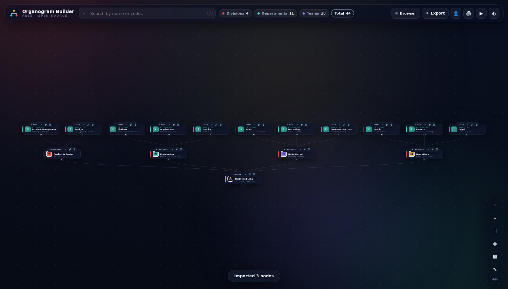
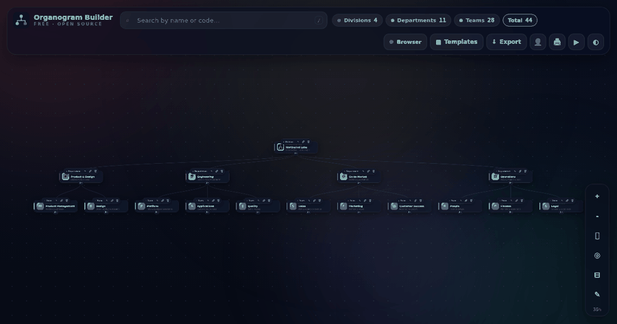
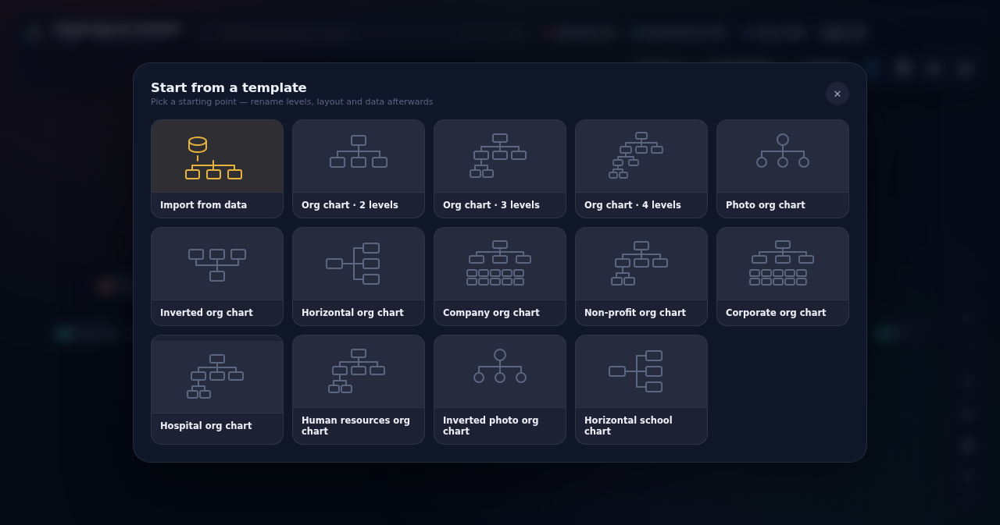

# Organogram Builder

A free, open-source **organogram builder** — make organizational charts right in your browser. Import a spreadsheet, drag your structure into shape, and export to PDF, Excel, CSV or PowerPoint. No sign-up, no servers, nothing to install if you don't want to.

**Live app → [orgbuilder.720p.red](https://orgbuilder.720p.red)**



## How it works



---

## What it does

- **Start from a template** — company, corporate, non-profit, hospital, HR, school, photo, inverted, horizontal, or a plain 2/3/4-level chart. Or import your own.
- **Build any hierarchy** — five levels out of the box (Organization → Division → Department → Team → Unit), and you can rename every level to match how your org actually talks.
- **Import from Excel or CSV** — point it at a sheet with `Name` and `Parent` columns and it draws the chart for you.
- **Four layouts** — top-down, left-right, and bottom-up (inverted), plus a people view that puts faces and titles on every box.
- **Export everywhere** — PDF report, Excel, CSV, and a ready-to-present PowerPoint deck. All generated in the browser.
- **A whiteboard on top** — pen, line, arrow, rectangle and ellipse tools to annotate the board, plus a presentation mode.
- **Right-click anything** — a context menu on every node (add, edit, reconnect, collapse, delete) and on the canvas (fit, templates, layout, people).
- **Search, re-parent, pin** — jump to any node, drag a node under a new parent, and pin detail panels to a board.



> A free **org chart maker** / **organizational chart generator** that runs entirely in your browser — no account, no servers.

## Your data stays yours

There is no backend. Everything lives in your browser:

- Your chart is saved to the browser as you work, so it survives closing the tab and reopening the page.
- Nothing is uploaded anywhere. No account, no tracking, no cookies.
- **Clear everything** from the Export menu wipes it, and a hard refresh clears the cache.
- Want a real file on disk? **Export → Use a local database file** writes every change straight to a `.json` file on your machine (Chrome/Edge), so you can keep it in a folder, sync it, or back it up however you like.

Because there's no shared server state, the hosted app handles any number of people at once — every visitor works entirely on their own device.

## Quick start

You only need the files — there's no build step.

**Just open it:** download the repo and open `index.html` in your browser. Done.

**Run a tiny local server** (so Excel import and the local-database file work without browser restrictions):

```bash
git clone https://github.com/720pixel/Organogram-Builder.git
cd Organogram-Builder
npm start            # → http://localhost:3000   (uses Node, zero dependencies)
```

No Node? Any static server works:

```bash
python3 -m http.server 3000      # → http://localhost:3000
```

## Importing from a spreadsheet

Export → **Import from Excel / CSV**. The first row is a header. Recognised columns (case-insensitive, only `Name` is required):

| Column   | Meaning                                              |
|----------|------------------------------------------------------|
| `Name`   | The node's name (**required**)                       |
| `Parent` | The `Name` of its parent. Blank = top of the chart   |
| `Level`  | Organization / Division / Department / Team / Unit (or your renamed levels) |
| `Code`   | Short code shown on the node                          |
| `Lead`   | Person who leads the node                             |
| `Title`  | Their title (CEO, VP, Manager…)                       |
| `Notes`  | Location, focus, headcount, remarks                  |

A ready-made example is in [`sample-org.csv`](sample-org.csv). `.xlsx`, `.xls` and `.csv` are all supported; CSV always works offline.

## Self-hosting

It's a folder of static files — host it anywhere (GitHub Pages, Netlify, Cloudflare Pages, or your own box). For nginx:

```nginx
server {
    server_name your-domain.example;
    root /var/www/organogram-builder;
    index index.html;
    location / { try_files $uri $uri/ /index.html; }
}
```

## How it's built

- One `index.html` — vanilla HTML, CSS and JavaScript, no framework, no build.
- [SheetJS](https://sheetjs.com) is vendored under `assets/vendor/` for Excel parsing, loaded only when you import.
- PDF export uses the browser's print-to-PDF; the PowerPoint `.pptx` is assembled from scratch in the browser.

```
index.html        the whole app
favicon.svg       icon
serve.js          zero-dependency local server (npm start)
assets/vendor/    SheetJS (Excel import)
sample-org.csv    example import
```

## Contributing

Issues and pull requests are welcome. Keep it dependency-light and the single-file approach intact where you can.

## License

[MIT](LICENSE) — use it, fork it, ship it.
